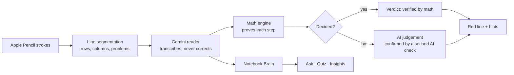

# RedLine

**The iPad notebook that checks your thinking, not just your answer.** Built in 24 hours at HackRU Fall 2026 (Education track).

Write math with an Apple Pencil like you would in any notes app. Pause, and RedLine reads your handwriting, proves every step with a math engine, and draws a red line under the first step that goes wrong. Tap "Look here" for a Socratic hint that points you at the mistake without giving away the fix.

**Try it:** [scratchwork-psi.vercel.app](https://scratchwork-psi.vercel.app) (best on an iPad with Apple Pencil: Safari, Share, Add to Home Screen; on a computer, turn on "Draw with finger" in the ⋯ menu to draw with the mouse).

## What it does

- **Live Check.** Checking starts when you pause or begin the next line. Every line gets a verdict, labeled **verified by math** or **AI judgement**, so you always know which one you can trust.
- **One red line, not a sea of red.** Only the first wrong step is marked. Later lines are checked against what you actually wrote, so a single slip doesn't make everything after it look wrong.
- **Hints that teach.** Up to three hints, each more specific than the last, read aloud. You can answer by voice. A hint never shows the corrected line. "Show me why" graphs what your step did to the equation.
- **Algebra through calculus.** The engine handles:
  - linear and quadratic equations, factoring, lists of solutions (`x = 2 or x = 3`)
  - inequalities, including chained ones, and catches a sign that should have flipped
  - equations in up to three variables (`y = 2x + 1 → y − 1 = 2x`)
  - lost solutions (dividing by x) and extra ones from squaring both sides
  - derivatives, indefinite and definite integrals, and limits (finite, at infinity, one-sided, does not exist)
- **Side-by-side problems.** Problems written in columns are checked separately.
- **Ask your notebooks.** Ask questions about everything you've written, with answers that link to the page they came from. Lasso a region of a page to ask about just that part.
- **Quiz me.** Quizzes come from your own notes and focus on what you get wrong. Choose presets or set the count, difficulty, topics, timer and hints. Questions use real math notation, and you answer by hand on a quiz page that grades itself.
- **Insights.** A mastery estimate for each topic (Bayesian Knowledge Tracing) and a concept map of how your topics connect.
- **A real notebook.** Pen, fineliner, pencil and highlighter; stroke and precise erasers; paper templates; palm rejection; dark mode; a guided tour. Install it to the iPad Home Screen as an app.

## How it works



**Gemini only reads.** We find the handwritten lines from the pen strokes ourselves (clustering by height, splitting columns at wide gaps, grouping problems at blank space) and label them `L1, L2, …` in the image. Gemini transcribes each one exactly as written, mistakes included, and is told never to fix anything.

**The math engine decides.** Built on mathjs, deterministic, no AI:

- *Equivalent steps:* each line is compared with the one above. If one equation is a constant multiple of the other at random points, the step is correct. Otherwise the real solution sets are compared: losing a solution is an error, gaining one is allowed only when squaring or clearing a denominator explains it.
- *Inequalities:* both lines must be true for exactly the same values. If they disagree everywhere and flipping the sign would make them match, the student kept the sign when dividing by a negative.
- *Derivatives:* your answer is compared with a numerical derivative of the original at sample points. *Integrals:* we differentiate your answer, which checks any method (u-substitution, by parts, tables). Definite integrals use Simpson's rule.
- *Limits:* we sample closer and closer to the point from each side and check that the function approaches your value.

When the engine can't decide (a substitution, words mixed in), the AI's verdict is used and labeled as AI judgement. A red line from the AI alone needs a second, focused AI check to agree. If the handwriting was hard to read, RedLine asks "Did you write …?" instead of marking you wrong.

**Fast.** Lines that haven't changed are never re-read, so a check usually sends only the newest line. When nothing new needs reading, the math re-runs in a fraction of a second.

**Private by default.** Notebooks live on the device (IndexedDB). Only the lines being checked are sent for reading.

## Run it

```bash
npm install
cp .env.example .env.local   # add GEMINI_API_KEY (ElevenLabs is optional, for the spoken hints)
npm run dev                  # http://localhost:3000
npm test                     # 140 unit tests: math engine, segmentation, quiz grading
```

On an iPad, open [scratchwork-psi.vercel.app](https://scratchwork-psi.vercel.app) in Safari, then Share, **Add to Home Screen**.

Every API route accepts `?mock=1` and returns sample data, so the whole app works without API keys or network (add it to a notebook's URL).

## Stack

Next.js 16 · React 19 · TypeScript · Tailwind CSS v4 · perfect-freehand · Dexie (IndexedDB) · Gemini API · ElevenLabs · mathjs · KaTeX · d3-force · Vitest · Vercel

## Team

Nico, Daniel and Dustyn, at HackRU Fall 2026. AI-assisted coding tools were used during the hackathon.
